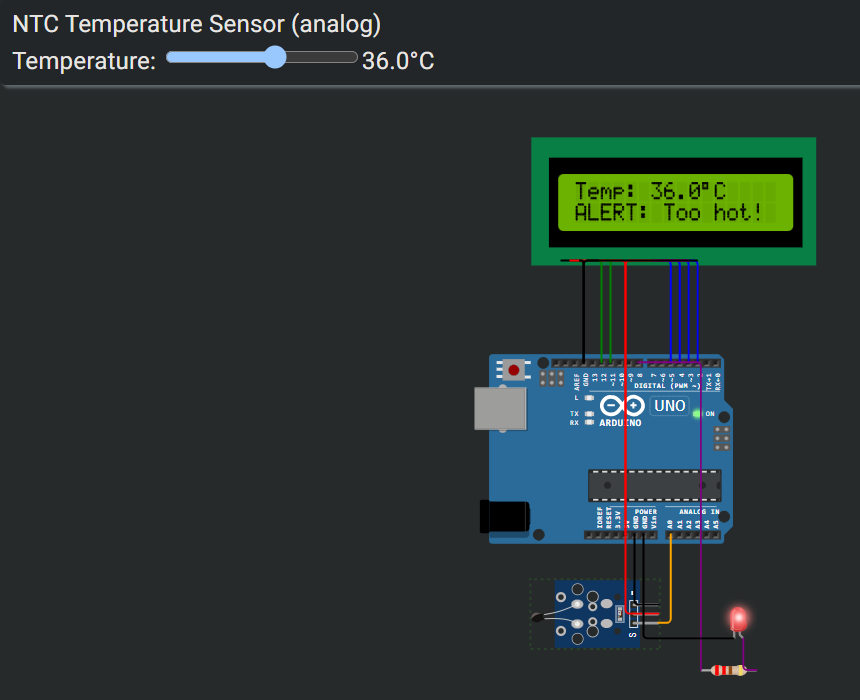
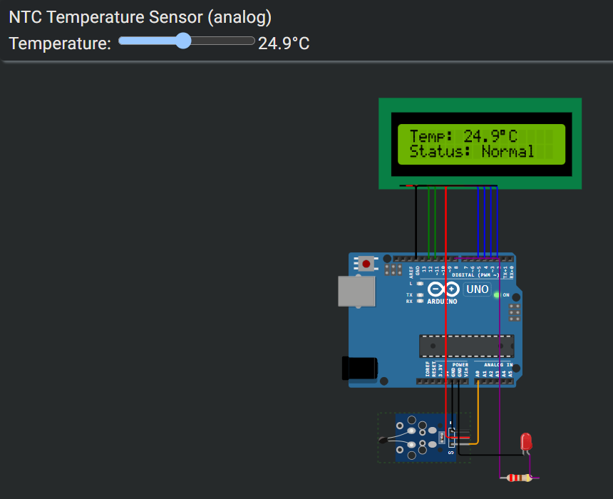

# Temperature Monitor (Arduino Uno + LCD + LED)

An Arduino Uno project, simulated in Wokwi, that reads temperature from an NTC sensor, shows it on a 16x2 LCD, and lights an LED when the temperature goes above 25 °C.

**Simulation:** [Open in Wokwi](https://wokwi.com/projects/479247504104829953)
**Write-up:** [Google Doc with steps and screenshots](https://docs.google.com/document/d/1H6dZH6A6J7BX7kb3cHhQb0T2I6QuLsfxveg_Ow-w4UU/edit?usp=sharing)

## How it works

1. The NTC thermistor gives an analog voltage on pin A0.
2. The Arduino converts it to degrees Celsius using the beta equation.
3. The temperature is shown on the LCD, with a status line.
4. If the temperature is above 25 °C, the LED on pin D8 turns on and the LCD shows "ALERT: Too hot!".

## Components

- Arduino Uno
- NTC temperature sensor (10 kΩ, β = 3950)
- 16x2 LCD (4-bit mode)
- Red LED and 220 Ω resistor

## Connections

| Part | Pin | Arduino |
| --- | --- | --- |
| LCD | RS, E | D12, D11 |
| LCD | D4, D5, D6, D7 | D5, D4, D3, D2 |
| LCD | VSS, V0, RW, K | GND |
| LCD | VDD, A | 5V |
| NTC sensor | VCC, GND, OUT | 5V, GND, A0 |
| LED | Anode (via 220 Ω), cathode | D8, GND |

## Files

- `sketch.ino`: the Arduino code
- `diagram.json`: the Wokwi circuit (import it into a Wokwi Arduino Uno project)

## Run it

1. Create a new Arduino Uno project on [wokwi.com](https://wokwi.com).
2. Paste `sketch.ino` and `diagram.json` into the project.
3. Click Start, then click the sensor and drag its temperature slider past 25 °C.

## Screenshots

### Alert above 25 °C

### Normal below 25 °C

## Possible improvements

- Add hysteresis so the LED doesn't flicker around 25 °C
- Add a buzzer as a second alert
- Rebuild it on an ESP32 and send the readings over WiFi

## Author

Suyash Baskaran: [GitHub](https://github.com/suyashh6969) · [LinkedIn](https://www.linkedin.com/in/suyash-baskaran-5295063ba/)
